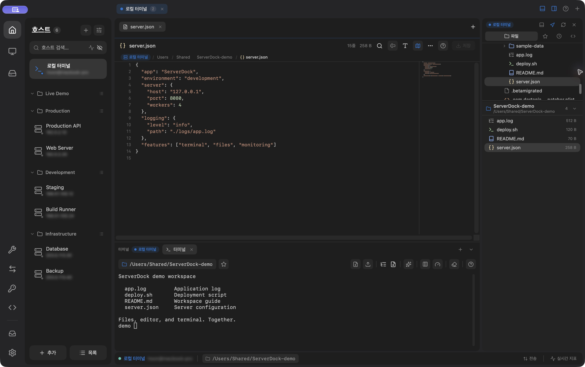

<div align="center">

[English](README.md) · **한국어**

<picture>
  <source media="(prefers-color-scheme: dark)" srcset="assets/logo-dark.svg">
  
</picture>

**macOS용 원격 서버 통합 작업 도구**

SSH · SFTP · 터미널 · 원격 데스크톱 · 포트포워딩 · 서버 모니터링

[](https://github.com/jh78bb/server-dock/releases)

[](LICENSE.md)

<br>

<a href="website/serverdock/img/workspace-private-ko.png">
  
</a>

<sub>한국어 화면 · 로컬 데모 작업 공간 · <a href="https://serverdock.papo.co.kr/">공식 사이트</a>에서 사용하는 스크린샷</sub>

</div>

## 소개

**ServerDock**은 SSH 터미널, SFTP 파일 관리, 원격 데스크톱, 포트포워딩, 서버 모니터링을 한 공간에서 사용하는 macOS 앱입니다. SwiftUI와 AppKit으로 만들었습니다.

이 프로젝트는 **상업화를 목적으로 하지 않으며**, [PolyForm Noncommercial License 1.0.0](LICENSE.md)에 따라 비상업적 용도로 소스를 공개합니다. 같은 조건의 버그 수정, 번역, 문서 기여를 환영합니다.

## 공식 링크와 배포 계획

- **공식 사이트:** [serverdock.papo.co.kr](https://serverdock.papo.co.kr/)
- **소스·이슈:** [jh78bb/server-dock](https://github.com/jh78bb/server-dock)
- **GitHub Releases:** 추후 CI를 구축해 빌드·서명·공증·릴리스 업로드를 자동화할 예정입니다. 기존 릴리스 스크립트와 워크플로를 바탕으로 구성하고 전체 배포 과정을 검증합니다.
- **Mac App Store:** 추가 배포 경로로 추진할 계획입니다. 기존 `ServerDock-MAS` 타깃의 샌드박스 동작, 서명, 라이선스 조건과 심사 요건을 확인해 출시 가능성을 검토합니다.

CI 릴리스가 준비되기 전에는 아래 소스 설치 방법을 사용할 수 있습니다. 배포 파일은 공식 사이트와 [GitHub Releases](https://github.com/jh78bb/server-dock/releases)에 안내할 예정입니다.

## 주요 기능

| 분야 | 기능 |
|---|---|
| SSH·터미널 | OS SSH 설정 또는 내장 libssh2 엔진, 키·에이전트·점프 호스트 |
| 파일·편집기 | SFTP 전송, 원격 텍스트 편집, 실시간 로그, 저장 공간 분석 |
| 원격 데스크톱 | FreeRDP 기반 RDP와 RoyalVNCKit 기반 VNC |
| 터널·스토리지 | 포트포워딩, SMB·WebDAV·S3 호환 스토리지·SFTP |
| 서버 운영 | 모니터링, 서비스·프로세스·컨테이너·방화벽 관리 |
| 명령·AI | 스크립트, 여러 서버에서 명령 실행, Mac 또는 서버의 AI CLI |
| 작업 공간 | 호스트·탭 관리, 명령 팔레트, 테마, 앱 잠금 |

사용 방법과 제한은 [상세 기능 안내](docs/FEATURES.ko.md)에 있습니다. 원격 시스템, 설치된 도구, 계정 권한과 빌드 구성에 따라 지원 범위가 달라집니다.

## 요구 사항

- **Apple Silicon Mac**, macOS 14 Sonoma 이상. 현재 Intel Mac은 빌드 대상이 아닙니다.
- 소스 빌드: 전체 Xcode 16 이상, XcodeGen, Swift 패키지를 가져올 인터넷 연결. 이번 점검에서는 Xcode 27.2로 새 Debug 빌드를 확인했으며 Xcode 16은 다시 검증하지 않았습니다.
- 원격 연결: 접근 권한이 있는 서버와 로그인 계정.

## 설치

CI 릴리스가 준비되면 [GitHub Releases](https://github.com/jh78bb/server-dock/releases)에서 배포 파일과 해당 버전의 서명·공증·업데이트 안내를 확인할 수 있습니다. 현재는 소스에서 빌드·설치할 수 있습니다.

### 이 Mac에 빌드·설치

```bash
brew install xcodegen
git clone https://github.com/jh78bb/server-dock.git
cd server-dock
./scripts/install-local.sh
```

전체 Xcode가 개발 도구로 선택되어 있어야 합니다. 실행 중인 ServerDock은 먼저 종료하세요. 스크립트는 프로젝트 생성 → Release 빌드 → 로컬 ad-hoc 서명 → `/Applications/ServerDock.app` 설치를 진행하며 기존 앱을 교체합니다. 설치 경로에 쓰기 위해 관리자 권한을 요청할 수 있습니다. 로컬용 서명이며 Apple 공증을 뜻하지 않습니다.

개발용 빌드는 `CONFIGURATION=Debug ./scripts/install-local.sh`로 설치합니다. 빌드 로그는 `.xcbuild/local-install/build.log`에 저장됩니다.

### 설치하지 않고 컴파일만 확인

```bash
xcodegen generate
xcodebuild -project ServerDock.xcodeproj -scheme ServerDock \
  -configuration Debug -destination 'platform=macOS,arch=arm64' \
  -derivedDataPath .xcbuild/debug CODE_SIGNING_ALLOWED=NO build
```

개발 인증서 없이 컴파일을 확인하는 명령입니다. 직접 배포 타깃의 Debug 구성은 로컬 ad-hoc 서명을 사용하므로 개발 인증서 없이 Xcode에서 실행할 수 있습니다. 앱 설치에는 위의 로컬 설치 스크립트를 사용하고, 외부 배포에는 자신의 서명 인증서를 준비하세요. 소스 추가·삭제 또는 `project.yml` 변경 후에는 `xcodegen generate`를 다시 실행합니다. 개발 규칙은 [CONTRIBUTING.md](CONTRIBUTING.md)를 참고하세요.

## 빠른 시작

1. **Hosts**에서 `+`를 눌러 SSH 주소, 포트, 계정과 인증 방법을 입력합니다.
2. 호스트 개요에서 **Terminal** 또는 **Files**를 엽니다. 처음 연결하는 서버는 지문을 확인한 뒤 신뢰하세요.
3. 원격 데스크톱 패널에서 RDP·VNC 호스트를 추가합니다.
4. 터널이 필요하면 **Port Forwarding**에서 규칙을 만들고 시작합니다.
5. 한국어 화면은 **Settings › General › Language › 한국어**를 선택한 뒤 앱을 다시 실행하면 적용됩니다.

앱과 문서는 영어가 기본입니다. 일본어·스페인어·브라질 포르투갈어도 선택할 수 있으며, macOS 언어를 따르려면 **System**을 직접 선택합니다. 번역이 없는 문구는 영어로 표시합니다.

## 데이터와 실행 권한

앱에 저장하는 연결 비밀번호와 SSH 키 라이브러리는 macOS Keychain을 사용합니다. 호스트 설정, 메모, 스크립트, AI 대화와 명령 실행 기록에는 민감한 내용이 남을 수 있습니다. 서버 내보내기는 연결 비밀번호와 개인 키를 제외하지만, 공유 전 메모와 명령도 확인하세요.

SSH Key Manager는 `~/.ssh` 또는 선택한 디렉터리의 실제 키 파일을 관리합니다. Keychain 기반 앱 키 라이브러리와 별개이므로 변경할 파일은 미리 백업하세요.

AI 기능은 실행할 위치에 설치·로그인한 CLI를 사용합니다. 해당 CLI가 프롬프트와 서버 내용을 외부 서비스에 보내거나 로그인 계정 권한으로 명령을 실행할 수 있습니다. 앱 잠금 중에도 연결·전송·터널은 계속 실행됩니다.

## 문서

| 문서 | 내용 |
|---|---|
| [상세 기능 안내](docs/FEATURES.ko.md) · [English](docs/FEATURES.md) | 사용 방법과 제한 |
| [기여 안내](CONTRIBUTING.md) | 개발 환경과 PR 절차 |
| [보안 정책](SECURITY.md) | 비공개 취약점 제보 |
| [릴리스 가이드](docs/RELEASING.md) | 관리자용 패키징·업데이트 설정 |
| [App Store 빌드 안내](docs/APP_STORE.ko.md) · [English](docs/APP_STORE.md) | 별도 샌드박스 타깃과 검증 항목 |
| [외부 의존성 고지](docs/THIRD_PARTY_NOTICES.md) | 원저작자와 라이선스 목록 |
| [변경 이력](CHANGELOG.md) | 버전별 기록 |
| [행동 강령](CODE_OF_CONDUCT.md) | 커뮤니티 참여 기준 |

## 라이선스와 감사의 말

[PolyForm Noncommercial 1.0.0](LICENSE.md)을 적용하며 원본 [termo](https://github.com/icloudza/termo) 프로젝트와 cloudza의 필수 고지를 유지합니다. 예상되는 상업적 적용 없이 하는 개인 학습·실험·취미 활동 등은 라이선스에 명시된 허용 목적에 포함됩니다. 수정과 재배포에도 라이선스 조건과 고지 의무가 적용됩니다.

관리자가 상업화하지 않는다는 방침이 다른 사용자의 이용 조건이나 외부 의존성의 조건을 바꾸지는 않습니다. 구체적인 허용 범위는 라이선스 원문을 따르며, README에서 별도의 권한을 추가로 부여하지 않습니다. 상업적 목적을 제한하는 라이선스이므로 **비상업적 이용을 위한 소스 공개 프로젝트**로 안내합니다.

외부 구성 요소에는 각각의 라이선스가 적용됩니다. [외부 의존성 고지](docs/THIRD_PARTY_NOTICES.md)를 참고하세요. 원본 개발자와 수정·번역에 참여하는 모든 분께 감사합니다.

Required Notice: Copyright 2026 cloudza (https://github.com/icloudza/termo)
