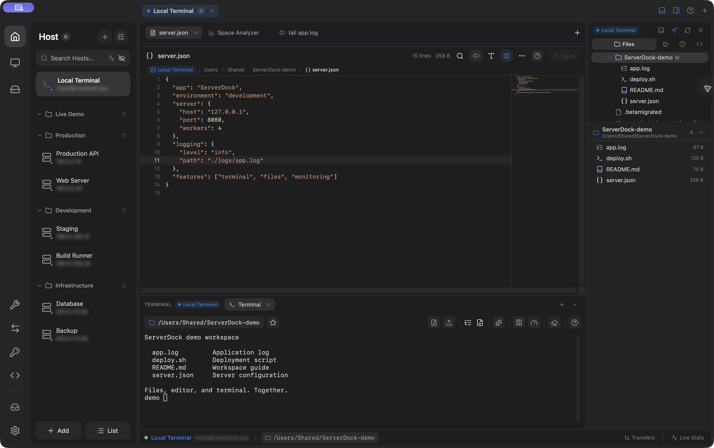

<div align="center">

**English** · [한국어](README.ko.md)

<picture>
  <source media="(prefers-color-scheme: dark)" srcset="assets/logo-dark.svg">
  
</picture>

**An all-in-one native macOS remote workbench**

SSH · SFTP · Terminal · Windows Remote Desktop · Port forwarding · Host monitoring

[](https://github.com/jh78bb/server-dock/releases)
[](https://github.com/jh78bb/server-dock/releases)
[](https://github.com/jh78bb/server-dock/stargazers)

[](LICENSE.md)

<br>

<a href="website/serverdock/img/workspace-private-en.png">
  
</a>

<sub>English interface · Local demo workspace · Screenshot from the <a href="https://serverdock.papo.co.kr/">official website</a></sub>

</div>

---

## Overview

ServerDock is a native macOS workspace for SSH terminals, SFTP files, remote desktops, port forwarding, and server monitoring, built with SwiftUI and AppKit.

This project is shared for **noncommercial use** under the [PolyForm Noncommercial License 1.0.0](LICENSE.md). The maintainer does not intend to commercialize it. Contributions, translations, and bug reports are welcome under the same terms.

## Project links and distribution plans

- **Website:** [serverdock.papo.co.kr](https://serverdock.papo.co.kr/)
- **Source and issues:** [jh78bb/server-dock](https://github.com/jh78bb/server-dock)
- **GitHub Releases:** planned through CI automation for building, signing, notarization, and publishing. The existing release scripts/workflow are a starting point; CI setup and end-to-end verification remain ahead.
- **Mac App Store:** an additional distribution goal, subject to sandbox validation, signing, licensing checks, and App Review. The separate `ServerDock-MAS` target is already present.

Until CI releases are available, use the local source installation below. Release downloads will be announced on the website and [GitHub Releases](https://github.com/jh78bb/server-dock/releases).

## Features

| Area | What you can do |
|---|---|
| SSH & terminals | Use your OS SSH configuration or the built-in libssh2 engine; manage keys, agents, and jump hosts. |
| Files & editor | Browse SFTP files, transfer files, edit remote text, follow logs, and inspect disk usage. |
| Remote desktop | Connect to RDP and VNC hosts with FreeRDP and RoyalVNCKit. |
| Tunnels & storage | Manage port forwards and connect to SMB, WebDAV, S3-compatible storage, and SFTP. |
| Server tools | Monitor hosts and manage supported services, processes, containers, and firewall rules. |
| Commands & AI | Save scripts, run commands across hosts, and use an AI CLI on this Mac or a server. |
| Workspace | Organize hosts and tabs, use the command palette, choose a theme, and lock the app. |

See the [detailed feature guide](docs/FEATURES.md) for workflows, limits, and build-specific differences. Features depend on the remote system, installed tools, and account permissions.

## Requirements

- macOS 14 Sonoma or later on an **Apple Silicon Mac**. Intel Macs are not currently targeted.
- Source builds: full Xcode 16 or later, XcodeGen, and internet access to resolve Swift packages. A fresh Debug build was verified with Xcode 27.2; Xcode 16 has not been revalidated in this documentation pass.
- An account on a server you are authorized to access for remote connections.

## Install

When CI releases are available, download from [GitHub Releases](https://github.com/jh78bb/server-dock/releases) and check the release notes for signing, notarization, and update information. You can build and install from source now.

### Build and install on this Mac

```bash
brew install xcodegen
git clone https://github.com/jh78bb/server-dock.git
cd server-dock
./scripts/install-local.sh
```

Select a full Xcode installation before building. Quit ServerDock before running the installer. It generates the project, builds Release, applies a local ad-hoc signature, and installs to `/Applications/ServerDock.app`, replacing an existing installation. It may request administrator permission to write there. This signature is for local use; it is not Apple notarization.

Use `CONFIGURATION=Debug ./scripts/install-local.sh` for a development build. The build log is `.xcbuild/local-install/build.log`.

### Compile without installing

```bash
xcodegen generate
xcodebuild -project ServerDock.xcodeproj -scheme ServerDock \
  -configuration Debug -destination 'platform=macOS,arch=arm64' \
  -derivedDataPath .xcbuild/debug CODE_SIGNING_ALLOWED=NO build
```

This checks compilation without a signing certificate. The direct target uses local ad-hoc signing for Debug runs in Xcode, without a development certificate. Use the local installer to install the app; distribution signing requires your own credentials. Re-run `xcodegen generate` after adding or removing sources or changing `project.yml`. See [CONTRIBUTING.md](CONTRIBUTING.md) for development conventions.

## Quick start

1. Open **Hosts**, click `+`, and add your SSH address, port, account, and authentication method.
2. Open the host overview, then choose **Terminal** or **Files**. Verify a new host fingerprint before trusting it.
3. Add RDP or VNC hosts from the remote desktop panel.
4. Create and start tunnel rules under **Port Forwarding** when needed.
5. To use Korean, select **Settings › General › Language › 한국어** and restart the app.

English is the default for the app and project documents. Japanese, Spanish, Brazilian Portuguese, and an explicit **System** language option are also available. Untranslated strings fall back to English.

## Data and permissions

Saved connection passwords and the app's SSH key library use macOS Keychain. Host profiles, notes, scripts, AI conversations, and command history can contain sensitive information even when they contain no saved password. Server exports exclude connection passwords and private keys; review notes and commands before sharing them.

SSH Key Manager also works with actual key files in `~/.ssh` or a selected directory. These files are separate from the app's Keychain-backed key library. Back up files you intend to change.

AI features run a CLI that you install and authenticate where it executes. That CLI may send prompts and server content to its provider and may execute commands with your account's permissions. Sessions, transfers, and tunnels continue while the app is locked.

## Documentation

| Document | Purpose |
|---|---|
| [Feature guide](docs/FEATURES.md) · [한국어](docs/FEATURES.ko.md) | Detailed workflows and limitations |
| [Contributing](CONTRIBUTING.md) | Source setup and pull requests |
| [Security policy](SECURITY.md) | Private vulnerability reporting |
| [Release guide](docs/RELEASING.md) | Maintainer packaging and update configuration |
| [App Store build notes](docs/APP_STORE.md) · [한국어](docs/APP_STORE.ko.md) | Optional sandbox target and validation checklist |
| [Third-party notices](docs/THIRD_PARTY_NOTICES.md) | Upstream credits and notice inventory |
| [Changelog](CHANGELOG.md) | Recorded changes |
| [Code of conduct](CODE_OF_CONDUCT.md) | Community expectations |

## License and acknowledgments

ServerDock is published under [PolyForm Noncommercial 1.0.0](LICENSE.md), retaining the required notice for the upstream [termo](https://github.com/icloudza/termo) project by cloudza. Personal study, experimentation, and hobby use without an anticipated commercial application are among the permitted purposes described by the license. Modification and redistribution remain subject to its terms and required notices.

The maintainer's noncommercial intent does not change the license conditions for other users or dependencies. The license text governs; no broader permission is granted by this README. The project is described as **source available for noncommercial use** because its license restricts commercial purposes.

Third-party components retain their own terms; see [THIRD_PARTY_NOTICES.md](docs/THIRD_PARTY_NOTICES.md). Thanks to the upstream authors and everyone contributing fixes and translations.

Required Notice: Copyright 2026 cloudza (https://github.com/icloudza/termo)
